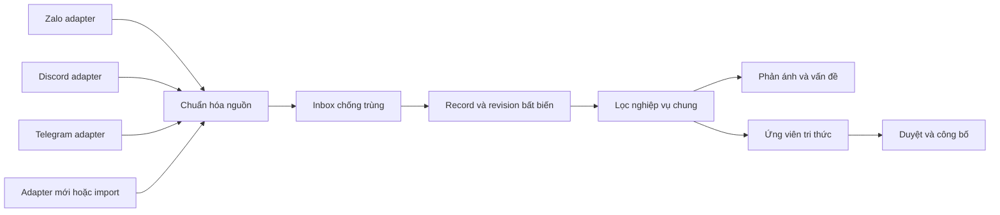

# Thiết kế nguồn dữ liệu đa nền tảng

Trạng thái: hợp đồng thiết kế backend, chưa có connector triển khai. Yêu cầu bổ sung ngày 02/11/2026: thêm được nguồn như Discord, Telegram và các nền tảng khác, không thiết kế lõi theo Zalo. Tài liệu này bổ sung [nghiệp vụ](nghiep-vu.md), [tech stack](tech-stack.md) và [ERD](erd.md).

[Mở sơ đồ luồng connector dạng SVG](diagrams/connector-flow.svg).

## 1. Ranh giới trách nhiệm



Adapter hiểu API, quyền, định danh, sự kiện, paging, rate limit và cấu trúc riêng của nền tảng. Lõi chỉ hiểu connection/channel/record/revision, chính sách xử lý và nguồn gốc dữ liệu.

Thêm nền tảng cần **adapter + kiểm thử adapter + cấu hình connection/quyền**. Với nguồn khớp hợp đồng chung, không cần sửa các bảng vấn đề, phản ánh, tri thức hoặc RAG. Không hứa rằng mọi nền tảng đều có cùng API hoặc có thể tích hợp chỉ bằng cách nhập tên/token.

## 2. Mô hình dữ liệu chung

| Đối tượng | Trách nhiệm |
|---|---|
| `source_platform` | Danh mục platform với code như zalo, discord, telegram. Thêm bản ghi, không ALTER enum nền tảng |
| `source_connection` | Kết nối và namespace định danh ổn định; adapter/version, cấu hình, tham chiếu secret, bằng chứng quyền, capabilities thực tế và phiên bản chính sách |
| `source_channel` | Phạm vi thu thập: group/channel/topic/mailbox/space/feed hoặc root của nguồn độc lập. Cursor, quyền và trạng thái được kiểm tra theo từng phạm vi |
| `source_record` | Đối tượng nguồn ổn định: message/document/ticket/comment/...; định danh ngoài, tác giả ngoài, quan hệ cha/thread, đường dẫn và trạng thái hiện hành |
| `source_record_revision` | Bản chụp nội dung và attachment từng lần create/update/delete. Không ghi đè revision đã dùng làm bằng chứng |
| `ingestion_event` | Inbox cho webhook/poll/import; khóa chống trùng, raw payload hạn chế quyền, trạng thái xử lý và lỗi để chạy tiếp |

Tên nền tảng không nằm trong FK của nghiệp vụ. Ví dụ:

```text
issue_submission.origin_source_record_id -> source_record.id
submission_evidence.source_record_revision_id -> source_record_revision.id
knowledge_provenance.source_record_revision_id -> source_record_revision.id
```

`source_type` chỉ phân biệt `ai_chat` và `external`. `knowledge_item.source_kind` phân biệt `faq`, `function_snapshot`, `external_context`; Discord/Zalo/Telegram là nguồn gốc, không phải mức tin cậy.

Ngoài tin nhắn, nguồn tài liệu/email/ticket có thể dùng cùng record/revision. Adapter quyết định phạm vi ID và cách chuẩn hóa nội dung; record_type không cho adapter tự cấp authority hay quyền công bố. Nếu sau này thêm nghiệp vụ gửi ra nền tảng, thiết kế outbox/capabilities riêng thay vì dùng inbox để gửi.

## 3. Hợp đồng adapter đề xuất

Các tên dưới đây là hợp đồng nội bộ đề xuất, không phải method được khẳng định có sẵn trong SDK nền tảng.

| Thao tác | Đầu vào → đầu ra |
|---|---|
| `describeCapabilities` | Phiên bản adapter và quyền connection → chức năng thực tế có thể đọc; không đánh dấu hỗ trợ nếu chưa xác minh |
| `verifyConnection` | Tham chiếu secret, cấu hình, scope → quyền đã xác minh hoặc lỗi phân loại; không trả secret trong log |
| `discoverChannels` | Connection và paging cursor → danh sách phạm vi được quyền đọc cùng next cursor |
| `pullChanges` | Channel, cursor, giới hạn batch → envelope sự kiện chuẩn hóa và next cursor; không yêu cầu tất cả nguồn có webhook |
| `verifyWebhook` | Header/body gốc và thông tin connection → envelope đã kiểm chứng hoặc từ chối; chỉ bật khi nền tảng/adapter có khả năng này |
| `normalize` | Envelope đã lưu → một hoặc nhiều record revision cùng identity, operation, version, metadata; không tạo issue trực tiếp |

Import file được phép là một kiểu adapter, vẫn cần định danh lô và bản ghi ổn định để chạy lại không tạo trùng. Adapter không được bypass việc lọc, kiểm tra quyền hay duyệt tri thức.

### Envelope chuẩn hóa tối thiểu

```json
{
  "schemaVersion": 1,
  "connectionId": "internal-uuid",
  "eventKey": "stable-business-event-key",
  "eventType": "record.updated",
  "channelExternalId": "opaque-channel-id",
  "recordExternalId": "opaque-record-id",
  "recordType": "message",
  "externalVersionKey": "opaque-version-or-null",
  "operation": "update",
  "sourceUpdatedAt": "2026-11-02T02:00:00Z",
  "orderingStatus": "verified",
  "senderExternalId": "opaque-sender-id",
  "parentRecordExternalId": null,
  "threadExternalId": null,
  "bodyInternal": "Nội dung đã chuẩn hóa trong phạm vi cho phép",
  "attachments": [],
  "providerMetadata": {},
  "adapterVersion": "1.0.0",
  "policyVersion": "collection-policy-1"
}
```

Đây là minh họa cấu trúc, không phải payload thật từ Discord/Telegram/Zalo. connectionId do hệ thống định tuyến từ cấu hình/webhook đã xác minh; không tin giá trị connection do một payload chưa xác thực tự khai.

## 4. Định danh, chống trùng và thay đổi nội dung

- Namespace gồm platform → connection → channel → external_record_id. Phải định nghĩa namespace đúng trong adapter, ví dụ chủ đề chỉ là metadata nếu message ID thực tế thuộc phạm vi channel cha. Không dùng display name/username làm khóa.
- Một namespace nguồn chỉ có một connection đang quản lý trong MVP. Nếu cần nhiều tài khoản/credential cùng đọc một namespace, tách credential binding hoặc dùng cùng canonical connection; không tạo nguồn trùng chỉ vì đổi token.
- `eventKey` ổn định cho cùng sự kiện nghiệp vụ. Dùng event ID/version ổn định của nguồn khi có; với polling/import dùng khóa ổn định của checkpoint/lô + phạm vi + record + thay đổi. Không tạo UUID mới cho mỗi lần retry và coi đó là chống trùng.
- Không có version/event ID đáng tin: adapter phải đối soát với trạng thái đã lưu, không tạo revision nếu không đổi, và giữ batch/checkpoint có thể phát lại. Không dùng riêng content_hash làm version unique vì A → B → A là lịch sử hợp lệ.
- Webhook được xác thực trước, ghi inbox bền vững rồi mới xác nhận tiếp nhận theo giao thức nền tảng; chuẩn hóa/lọc chạy bất đồng bộ. Cursor chỉ advance sau khi batch được ghi inbox an toàn; retry phần chưa xử lý từ inbox.
- `ingestion_event` unique theo connection/eventKey; revision unique theo record/event. Chỉ retry cùng event, không append lại revision. Một sự kiện batch có thể cập nhật nhiều record nhưng chỉ một revision cuối cho mỗi record trong sự kiện; nếu nguồn gửi nhiều thay đổi tuần tự cùng record trong một batch, adapter tách thành sub-event ổn định có ordinal riêng.
- `source_record_revision.ingestion_event_id` và record → channel → connection phải cùng connection. Backend kiểm tra bất biến chéo bảng này trong transaction; không chỉ dựa vào FK tồn tại độc lập.
- Khi update/delete đến lệch thứ tự, dùng sequence/version của nguồn nếu có. Timestamp thời điểm nhận không chứng minh thứ tự thay đổi. Trường hợp không thể kết luận chuyển `ordering_status=ambiguous` để đọc lại/đối soát.
- Raw payload nằm trong file_asset internal. Tệp đính kèm dùng metadata phiên bản và hash khi có, chỉ lấy nội dung nếu được phép; không coi URL thay đổi được là bằng chứng bất biến.

## 5. Quyền và công bố

- Mỗi connection/channel có quyền và chính sách đã xác minh. Capability chỉ nói “có thể đọc”, không đồng nghĩa được sử dụng mọi nội dung cho mọi user.
- Dữ liệu nguồn không tự trở thành hướng dẫn chính thức. Lọc → tóm tắt/khử nhạy cảm → xác nhận → duyệt/công bố đúng release/audience.
- Thu hồi quyền connection/channel: dừng job mới, kiểm tra lại quyền ở job đang chạy và loại nguồn dẫn xuất khỏi tập truy xuất theo chính sách. Chứng cứ audit cũ không tự bị ghi đè; retention/ẩn danh hóa là quy trình riêng.
- Record bị sửa/xóa: revision và citations lịch sử vẫn truy vết được, nhưng nguồn dẫn xuất cần đánh giá lại hiệu lực. Không tự tiếp tục trả từ external_context bị thu hồi chỉ vì đã có embedding.
- Không tự ánh xạ external_sender_id sang app_user. Nếu cần liên kết danh tính sau này phải có bước xác minh, không suy từ tên hiển thị hoặc số điện thoại trong tin nhắn.

## 6. Quy trình thêm một nền tảng

1. Chốt phạm vi cần đọc, khả năng API và quyền thực tế; khai báo platform cùng adapter/version.
2. Cài adapter triển khai hợp đồng chung, nêu capability thiếu và cơ chế import thay thế nếu có.
3. Tạo connection với secret reference, namespace, chính sách và authorization evidence; chọn channel cho phép.
4. Kiểm thử chuẩn hóa ID, paging/cursor, rate limit/retry, signature khi có webhook, duplicate, update/delete, thứ tự sự kiện, attachment và thu hồi quyền.
5. Chạy pilot; dữ liệu đi vào cùng pipeline lọc/tri thức/vấn đề. Không thêm bảng `discord_issue`, `telegram_knowledge` hoặc cột nền tảng mới vào bảng lõi.

Các giới hạn rate limit, webhook và quyền của từng nền tảng phải tra tài liệu chính thức tại lúc triển khai adapter. Bản thiết kế này chưa xác nhận API/quyền của bất kỳ nền tảng nào đã sẵn sàng.

## 7. Phiên bản hợp đồng và lỗi

- `schemaVersion` là phiên bản envelope chuẩn hóa; thay đổi thêm trường tùy chọn giữ tương thích. Đổi nghĩa hoặc bỏ trường phải có version/migration rõ, không để adapter tự làm lõi hiểu sai dữ liệu cũ.
- `adapter_key` trỏ adapter đã đăng ký/cho phép trong backend, ví dụ qua registry các Spring bean. Thêm dòng platform không có nghĩa tự có implementation; adapter chưa cài trả lỗi không hỗ trợ, không nạp tên class hay mã tùy ý từ cấu hình.
- Lỗi chung: `UNSUPPORTED_CAPABILITY`, `AUTH_FAILED`, `SCOPE_FORBIDDEN`, `RATE_LIMITED`, `TRANSIENT_FAILURE`, `INVALID_PAYLOAD`, `ORDERING_UNCERTAIN`. Lõi retry theo loại lỗi và thời điểm adapter đề nghị; không retry vô hạn credential sai hoặc payload hỏng.
- Các extension riêng ở providerMetadata có giới hạn kích thước và schema do adapter quản lý. Những trường dùng cho identity, quyền, nguồn gốc, version hoặc quyết định nghiệp vụ phải có vị trí chuẩn hóa rõ, không giấu trong JSON để lõi đoán theo platform.
- Job đang chạy phải kiểm tra lại collection_status và quyền hiện hành trước khi tạo tác động mới; policy/adapter version tại lúc nhập vẫn được giữ để kiểm toán.
