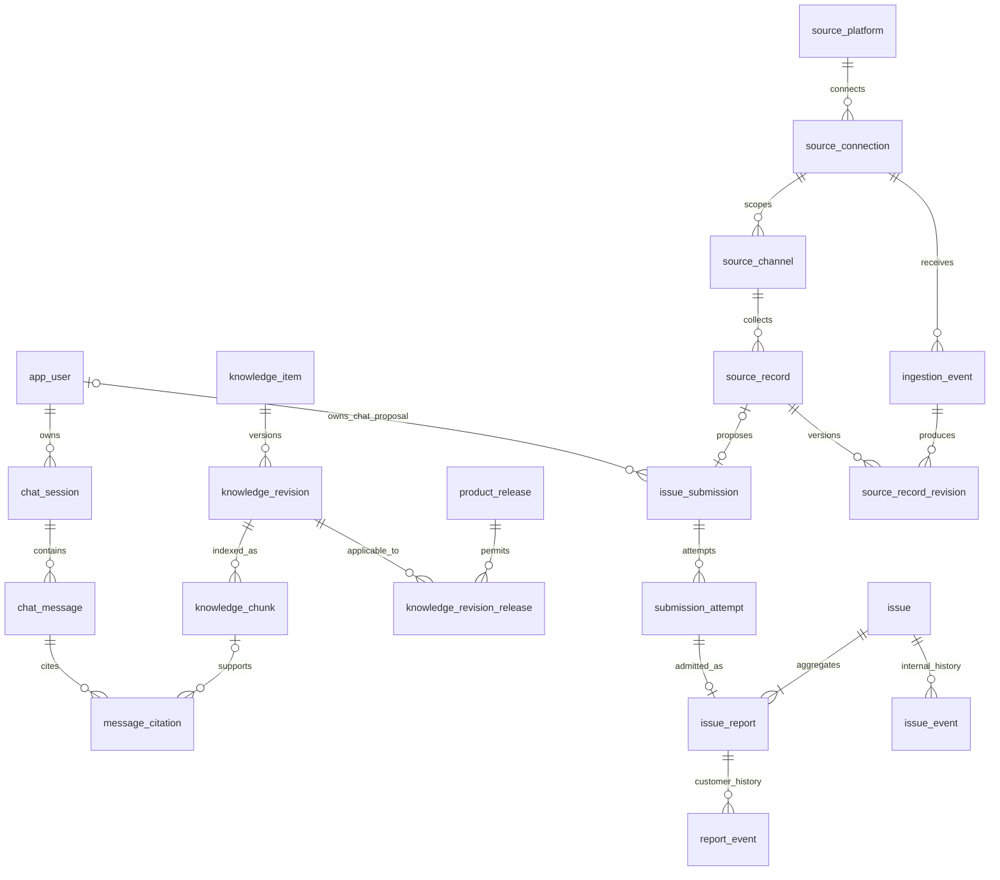
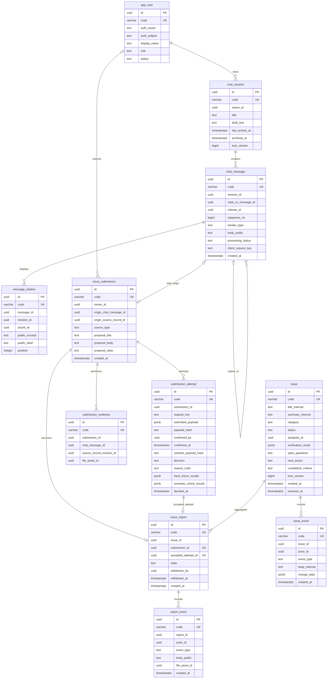
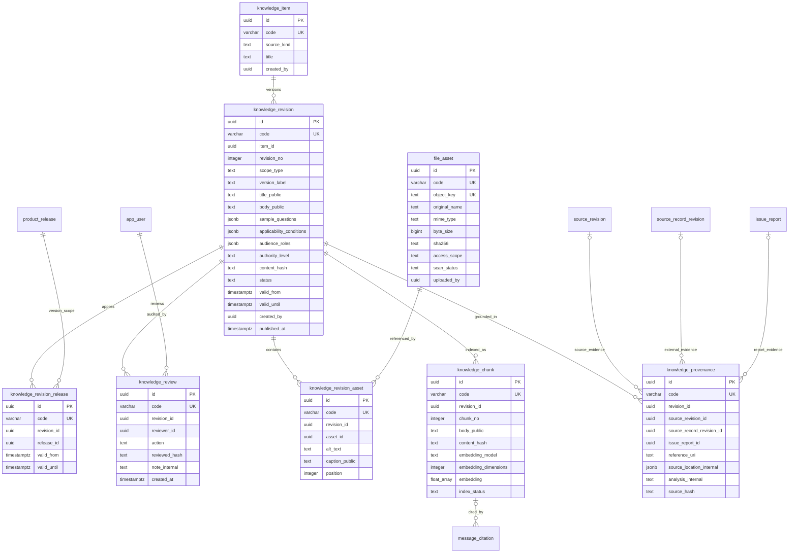
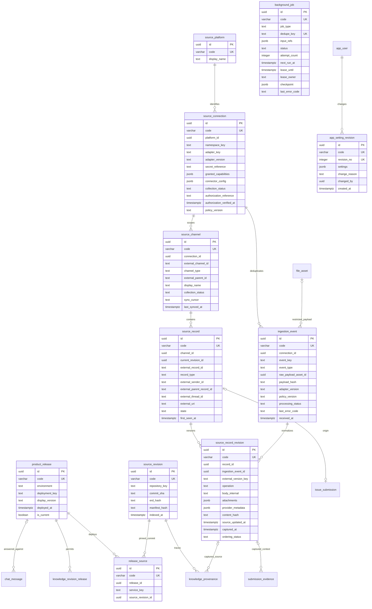

# ERD đề xuất — AI Integration

Ngày thiết kế: 02/11/2026. Trạng thái: SQL khởi tạo theo cụm đã có, chưa áp dụng vào database của bạn.

Quyết định mới nhất: MVP dùng tri thức tự nhập, chưa đọc repository/ERD/DB nghiệp vụ bên ngoài. Xem [phạm vi MVP](mvp-scope.md). Mỗi bảng giữ UUID PK và thêm code UNIQUE; mọi đường nối là quan hệ logic, **không khai báo foreign key hoặc trigger kiểm soát quan hệ**. [SQL và thứ tự chạy](../database/README.md) là định nghĩa vật lý hiện hành.

Nguồn yêu cầu: [nghiệp vụ v1.6](nghiep-vu.md), [tech stack](tech-stack.md) và [web mock](../index.html). Tài liệu nghiệp vụ là cơ sở quyết định; mô hình localStorage của mock chỉ minh họa UI, chưa đủ để chuyển thẳng thành bảng.

Yêu cầu mở rộng ngày 02/11/2026: nguồn thu thập phải thêm được từ Discord, Telegram hoặc nền tảng khác. Vì vậy Zalo chỉ là một platform trong mô hình chung. Xem [hợp đồng connector đa nền tảng](connectors.md); các tên bảng/thuộc tính nghiệp vụ không gắn cứng với một nhà cung cấp.

Sơ đồ đã xuất SVG để mở trực tiếp trong trình duyệt: [tổng quan](diagrams/erd-overview.svg), [hội thoại và tiếp nhận](diagrams/erd-support.svg), [kho tri thức](diagrams/erd-knowledge.svg), [nguồn dữ liệu và vận hành](diagrams/erd-operations.svg). Mã Mermaid gốc ở các phần tương ứng bên dưới.

## 1. Cách hiểu yêu cầu

| Nhóm | Yêu cầu dữ liệu phải đáp ứng |
|---|---|
| Tài khoản | Ba vai trò user, technician, admin. Phiên chat riêng cho từng tài khoản; technician không được duyệt tri thức hay cấu hình |
| Hội thoại | Lưu tin nhắn, bản nháp, lịch sử gần đây ngay khi mở app, trạng thái xử lý, thứ tự tin và nguồn câu trả lời |
| Tiếp nhận | Đề nghị gửi chưa phải phản ánh được ghi nhận. Lưu đúng nội dung đã xác nhận, kết quả lọc, lý do và khóa chống gửi lặp |
| Vấn đề | Một vấn đề tổng hợp nhiều phản ánh, nhiều người và nhiều nguồn. Giữ riêng quyền sở hữu, đính chính và rút của từng phản ánh |
| Kho tri thức | Mẫu hỏi đáp, snapshot chức năng và ngữ cảnh Zalo có nguồn gốc và mức tin cậy khác nhau; phiên bản, ảnh, điều kiện, phạm vi công bố phải được duyệt |
| Phiên bản | Câu trả lời dùng tri thức hợp lệ với bản đang triển khai, đối chiếu đúng source/ERD theo commit |
| Nguồn bên ngoài | Zalo, Discord, Telegram và nguồn khác đi qua connector → chuẩn hóa → lọc chung. Lưu đúng định danh nguồn, phiên bản nội dung, người gửi, thời gian, thread và trạng thái xử lý. MVP chỉ thu thập/import; không tự bổ sung quyền gửi ra nền tảng |
| Vận hành | Job nền tiếp tục được sau lỗi; retry không lặp phản hồi hoặc tạo thêm issue; cấu hình có lịch sử |

### Giả định thiết kế

- Một ứng dụng hỗ trợ cho một hệ thống sản phẩm. Chưa đưa multi-tenant, tổ chức hay phân quyền theo phòng ban vào schema khi yêu cầu chưa xác nhận.
- Mỗi tài khoản có một vai trò hiện hành trong MVP. BA/Dev/Tester là trách nhiệm công việc; chưa tự tạo thêm role ngoài ba role đã chốt.
- Có thể dùng SSO: `app_user` lưu khóa định danh ngoài, không tự thiết kế bảng mật khẩu khi chưa chọn cơ chế đăng nhập.
- Toàn bộ bảng thuộc một backend Spring Boot và một schema đề xuất `ai_support`; tên schema/bảng là đề xuất mới. Không tạo FK tới database nghiệp vụ của sản phẩm được hỗ trợ.
- Mỗi bảng có `id UUID PRIMARY KEY DEFAULT gen_random_uuid()` và `code VARCHAR(160) NOT NULL UNIQUE`; code do bạn/backend đặt theo ngữ nghĩa, liên kết vẫn dùng UUID. Thời gian dùng timestamptz; JSONB cho dữ liệu ngữ cảnh có cấu trúc thay đổi.
- Hình mô tả cột chính và quan hệ logic; SQL chứa cột kiểm toán chi tiết. Bảng nối cũng có UUID PK, code UNIQUE và UNIQUE cho cặp liên kết. Không có FK vật lý, cascade hoặc trigger kiểm soát quan hệ; backend/người quản lý dữ liệu tự kiểm soát.

## 2. ERD tổng quan

Quan hệ `issue` có ít nhất một `issue_report` là **bất biến nghiệp vụ sau commit**: tạo issue và report trong cùng transaction. FK đơn lẻ không ép được một bảng cha luôn có bảng con.

Các nhóm dưới đây định nghĩa **30 bảng của thiết kế đích**, gồm phần MVP nhập tay và phần mở rộng sau. Chạy 00/01/02 để thử kho tri thức/chat, thêm 03 khi thử phản ánh; các cụm 04/05/06 có thể để sau. Bảng lặp lại ở một sơ đồ vẫn là cùng một bảng.

## 3. Tài khoản, hội thoại và tiếp nhận vấn đề

### Vai trò và ràng buộc của 11 bảng

| Bảng | Ý nghĩa và ràng buộc chính |
|---|---|
| `app_user` | `UNIQUE(auth_issuer, auth_subject)`; role thuộc user/technician/admin. Khóa tài khoản không xóa lịch sử |
| `chat_session` | Một chủ sở hữu; bản nháp nằm trên phiên. Index `(owner_id, last_activity_at DESC, id)` cho lịch sử dùng ở sidebar chung. Sửa nháp dùng `lock_version` để tránh ghi đè giữa hai tab |
| `chat_message` | `UNIQUE(session_id, sequence_no)` và `UNIQUE(session_id, client_request_key)`. sender_type user/assistant; reply phải trong cùng phiên. Chỉ một câu trả lời cuối cho một tin user bằng unique có điều kiện trên reply của assistant. Retry tiếp tục cùng message, không thêm câu trả lời mới |
| `message_citation` | Chỉ gắn với tin assistant. revision_id bắt buộc; chunk_id có thể null khi MVP chưa có embedding. UNIQUE(message_id, position), unique có điều kiện cho message/chunk. Lưu trích đoạn/nhãn công bố tại lúc trả lời; không đưa raw code/ERD vào trích dẫn |
| `issue_submission` | Đề nghị trước tiếp nhận, chưa có mã VD-. source_type ai_chat/external, không mang tên nền tảng. Chat: owner và origin_chat_message bắt buộc, external origin null. External: origin_source_record_id bắt buộc, owner/chat origin null. Unique từng origin. proposal_state: proposed/declined/processing/admitted/closed |
| `submission_attempt` | Mỗi lần xác nhận/lọc là một bản ghi riêng. Payload là bản chụp **đúng nội dung user đã xem lại**. `UNIQUE(submission_id, request_key)`. decision: pending/pass/needs_detail/rejected/rate_limited. Xử lý lặp request không tạo attempt mới |
| `submission_evidence` | Bằng chứng bổ sung từ nhiều tin/ảnh; đúng một trong chat_message/source_record_revision/file_asset không null. Không tự cho user đọc tất cả bằng chứng của submission hay issue |
| `issue` | Đơn vị xử lý chung; mã hiển thị unique. Status waiting/working/done/withdrawn. Category question/needs_information/business_confirmation/suspected_bug/change_request; chỉ người được quyền mới xác nhận phân loại |
| `issue_report` | Một submission có tối đa một report được nhận. accepted_attempt phải thuộc đúng submission và có decision pass. Owner suy ra từ submission, không nhận từ client và không nhân bản danh sách người bị ảnh hưởng vào JSON |
| `report_event` | Lịch sử riêng: correction/response/withdrawal. Chỉ chủ phản ánh tương ứng và staff được đọc. correction không thay submitted_payload gốc. Staff phản hồi chung phải tạo bản công bố riêng cho từng report phù hợp |
| `issue_event` | Lịch sử nội bộ: phân công, chuyển trạng thái, kiểm chứng, phân loại, quyết định sơ bộ và liên kết công việc. Không trả vào DTO của user; không dùng một cờ frontend để che dữ liệu này |

Các tham chiếu thay thế theo nguồn như origin_chat_message_id/origin_source_record_id hoặc các cột evidence có thể null theo XOR; auditor/assignee có nullable riêng. Cardinality không biểu diễn đủ XOR hoặc kiểm tra chéo bảng. Tất cả là liên kết UUID logic, không phải FK vật lý.

### Tại sao cần ba mức submission → report → issue?

Ví dụ hai người A/B cùng gặp một tình huống, thêm một phản ánh Zalo:

- Ba `issue_submission`, mỗi submission lưu nguồn của mình.
- Chat A/B có xác nhận riêng và các lần lọc riêng. Zalo có lần lọc theo chính sách thu thập, không giả lập sự đồng ý của người gửi chat.
- Ba `issue_report` cùng trỏ tới một `issue`; mỗi report giữ bản nội dung được tiếp nhận qua accepted_attempt.
- A rút khi issue còn waiting: chỉ report A chuyển withdrawn. Report B và Zalo vẫn active, issue vẫn waiting.
- Chỉ khi không còn report active và issue chưa được xử lý, issue chuyển withdrawn. Không xóa issue/report/events.
- User A chỉ được thấy phản ánh A, các report_event của A và trạng thái công bố của issue; không thấy tiêu đề/tóm tắt nội bộ hoặc người B.

## 4. Tri thức, phiên bản nội dung và ảnh

### Vai trò và ràng buộc của 8 bảng

| Bảng | Ý nghĩa và ràng buộc chính |
|---|---|
| `knowledge_item` | Định danh ổn định; source_kind faq/function_snapshot/external_context. Không coi ba loại có cùng quyền xác lập nghiệp vụ |
| `knowledge_revision` | `UNIQUE(item_id, revision_no)`. Chứa bản nội dung có thể công bố, câu hỏi mẫu, điều kiện, audience và hash. audience_roles là JSON array không rỗng, chỉ gồm user/technician/admin và được backend kiểm tra theo schema cố định. authority_level confirmed_business/observed_behavior/unverified_context. status draft/pending_review/approved/published/rejected/expired |
| `knowledge_revision_release` | Mapping mở rộng sau: UUID PK và code UNIQUE, thêm UNIQUE(revision_id, release_id), thời hạn riêng từng release. Không dùng chuỗi phiên bản để suy tương thích. scope_type=manual của MVP không bắt buộc mapping này |
| `knowledge_review` | Lưu submit/approve/reject/publish/expire, người thực hiện, thời điểm và hash đã duyệt. Chỉ admin duyệt/công bố/cho hết hiệu lực. Technician chỉ soạn và gửi duyệt |
| `file_asset` | Metadata object storage, không lưu ảnh binary trong PostgreSQL. object_key bất biến; nội dung mới tạo asset mới. access_scope internal/restricted_public; không có bucket URL công khai vô điều kiện |
| `knowledge_revision_asset` | Danh sách ảnh, thứ tự và alt text thuộc **revision**, không gắn trực tiếp vào knowledge_item. Thay ảnh/alt/caption tạo revision cần duyệt lại |
| `knowledge_chunk` | Chỉ phần công bố đã khử nhạy cảm. UNIQUE(revision_id, chunk_no), một model/embedding hiện hành mỗi chunk. DDL dùng double precision[] tùy chọn, chưa yêu cầu pgvector; chốt model/kích thước và migration vector/index sau |
| `knowledge_provenance` | Metadata nguồn và phân tích nội bộ nằm riêng khỏi body_public. Mỗi hàng tham chiếu đúng một trong source_revision/source_record_revision/issue_report/reference_uri; nhiều bằng chứng dùng nhiều hàng |

### Bất biến của bản đã duyệt

1. Lưu thay đổi nội dung tạo revision mới; không UPDATE nội dung/điều kiện/audience/manifest ảnh của revision đã gửi duyệt. Workflow status và ngày hiệu lực vẫn có thể chuyển theo quy trình, có knowledge_review tương ứng.
2. `content_hash` bao gồm nội dung công bố, điều kiện, audience, danh sách release áp dụng và manifest ảnh (asset hash, alt, caption, thứ tự). Review xác nhận hash này, không chỉ hash phần chữ.
3. Sửa một bản đã published tạo draft/pending_revision mới. Đề xuất **giữ bản đã published cũ tiếp tục có hiệu lực** cho đến khi bản thay thế được duyệt và công bố; nếu nội dung cũ sai thì admin phải expire ngay. Đây là chính sách đề xuất cần chốt, mock hiện chưa thể hiện đầy đủ việc chạy song song hai revision.
4. Tại một thời điểm, mỗi knowledge_item chỉ có một revision published áp dụng cho cùng release; công bố bản thay thế cần khóa hàng knowledge_item và chuyển hiệu lực mapping bản cũ trong cùng transaction. Không expire toàn bộ revision cũ nếu nó còn dùng cho release khác: đóng `valid_until` ở bảng nối `knowledge_revision_release` của release cần thay. Thay đổi thời hạn do thu hồi/thay thế là chuyển hiệu lực có audit, không sửa payload đã duyệt.
5. `approved` chưa đủ để RAG trả lời. Phải published, còn thời hạn, có release mapping hiện hành, audience phù hợp, đáp ứng điều kiện nghiệp vụ, ảnh hợp lệ và không bị revoke.
6. External context (Zalo/Discord/Telegram/...) chỉ giải thích tình huống/tần suất; không phải căn cứ xác nhận nghiệp vụ. Muốn chuyển thành hướng dẫn chính thức, tạo item faq mới với căn cứ đã được người có trách nhiệm xác nhận, rồi duyệt/công bố.

## 5. Bản triển khai, nguồn đa nền tảng và vận hành

### Vai trò và ràng buộc của 11 bảng

| Bảng | Ý nghĩa và ràng buộc chính |
|---|---|
| `product_release` | Một lần triển khai trên một environment. `UNIQUE(environment, deployment_key)`; unique có điều kiện trên environment khi is_current=true. Đổi production phải atomically bỏ current cũ và chọn current mới |
| `source_revision` | `UNIQUE(repository_key, commit_sha, manifest_hash)`; metadata source/ERD dùng cho pipeline nền. Nếu ERD hash chưa có, phải ghi trạng thái thiếu trong manifest, không coi đã kiểm chứng đầy đủ |
| `release_source` | Mỗi release/service chỉ một source_revision; bảo đảm snapshot đối chiếu đúng manifest nhiều microservice, không gói toàn sản phẩm vào một commit giả định |
| `source_platform` | Danh mục dữ liệu: zalo/discord/telegram và các nền tảng thêm sau; code unique. Không dùng PostgreSQL enum cố định theo tên nền tảng |
| `source_connection` | Một kết nối có namespace định danh ID riêng. `UNIQUE(platform_id, namespace_key)`. Lưu adapter/version, cấu hình không chứa secret, quyền thực tế, bằng chứng cho phép thu thập và policy_version. Đổi credential không tạo lại namespace |
| `source_channel` | `UNIQUE(connection_id, external_channel_id)`. Đại diện group/channel/topic/mailbox/space/feed/root theo adapter; channel_type là dữ liệu, không ép mọi nền tảng thành group. Cursor riêng từng kênh; chỉ advance sau khi ghi nhận batch an toàn |
| `source_record` | `UNIQUE(channel_id, external_record_id)`. Định danh bản ghi ổn định; record_type message/document/ticket/comment/...; giữ quan hệ cha/thread bằng external ID và permalink. current_revision_id trỏ bản hiện hành đã đối soát của chính record, null khi chưa có bản đủ điều kiện. Không suy sender là app_user |
| `source_record_revision` | Nội dung từng phiên bản bất biến, gồm create/update/delete; `UNIQUE(record_id, ingestion_event_id)`. Không dùng content_hash làm version unique vì nội dung có thể đổi A → B → A. Evidence/provenance trỏ revision cụ thể, không trỏ nội dung hiện tại có thể đổi |
| `ingestion_event` | Inbox sự kiện bền vững: `UNIQUE(connection_id, event_key)`; raw payload ở file_asset internal, hash, policy và adapter version. Một webhook batch có thể sinh nhiều record revision; retry tiếp tục cùng event, không nhân bản bằng chứng |
| `background_job` | job_type source_sync/connector_ingest/knowledge_index/issue_review. Dedupe key từ loại tác vụ + scope + hash input; mỗi lần phát hành lại cần generation/hash mới khi cần chạy lại. Lỗi retry cùng hàng, giữ checkpoint và giới hạn retry |
| `app_setting_revision` | Cấu hình append-only, một revision tăng dần; người sửa bắt buộc admin. Lưu cờ thu thập, chính sách RAG/lọc, lịch nền; bí mật chỉ tham chiếu secret manager. Bản production hiện hành nằm ở product_release, không lặp lại trong JSON settings |

`background_job.input_refs` là metadata điều phối gồm ID/hash đã xác minh, **không phải FK đa hình**. Khi thực thi job backend phải tải lại và kiểm tra bản ghi nguồn; nếu cần tính toàn vẹn FK cho từng loại job, tách bảng con theo loại khi triển khai. Không dùng job table làm danh sách phản ánh hay nơi lưu kết quả nghiệp vụ duy nhất.

Với nguồn external, submission lưu định danh record ổn định và bắt buộc có evidence trỏ tới source_record_revision đã dùng để đề nghị/lọc. Backend kiểm tra revision đó thuộc origin_source_record_id. Cả evidence và provenance giữ đúng revision, không đọc lại “bản mới nhất” để dựng lại chứng cứ cũ. Bản ghi sửa/xóa ngoài nền tảng tạo revision mới và kích hoạt rà soát; không tự ghi đè payload của accepted_attempt hoặc tự tạo report thứ hai cho cùng origin.

`source_record.state` và current_revision_id là projection từ revision đã xác minh thứ tự, cập nhật atomically khi khóa record. Backend xác minh current_revision_id tồn tại và revision.record_id đúng với record hiện hành; không tạo FK kép hoặc trigger. Khi khởi tạo, tạo record với current null, thêm revision rồi cập nhật pointer trong cùng transaction. Không dùng thời điểm nhận webhook để cho sự kiện cũ ghi đè bản mới. Nếu adapter chưa chứng minh được thứ tự, ordering_status=ambiguous và đối soát trước khi cập nhật bản hiện hành.

## 6. Quy tắc phải thực thi khi viết backend

### 6.1. Sở hữu và dữ liệu công bố

- Truy vấn lịch sử: `chat_session.owner_id = authenticated_user.id`; áp dụng cả tải phiên, tin nhắn, sửa nháp và mở citation. Staff có công cụ xử lý issue không đồng nghĩa được đọc toàn bộ phiên chat riêng của user.
- Truy vấn phản ánh của tôi: join issue_report → issue_submission và lọc owner_id. Chỉ trả payload của accepted_attempt, report_event của report đó và trạng thái issue được công bố.
- Không trả `issue.*`, `issue_event`, `submission_evidence` đầy đủ, `knowledge_provenance`, raw payload bên ngoài hoặc danh sách report khác vào API dành cho user. Bằng chứng được user đồng ý gửi là phần chia sẻ cho staff; việc đó không cấp quyền đọc toàn bộ phiên chat.
- RAG truy xuất knowledge_chunk qua revision và release, lọc audience/hiệu lực trước khi dùng ngữ cảnh. Citation và endpoint ảnh kiểm tra lại quyền mỗi lần mở; nếu nguồn bị revoke, giữ lịch sử trích dẫn an toàn nhưng không mở nội dung đã thu hồi.

### 6.2. Đồng ý, lọc và ghi nhận

- Chat attempt có decision pass bắt buộc confirmed_by = submission.owner_id, confirmed_at khác null và consent_payload_hash = payload_hash. Backend tạo hash từ payload canonical; không tin hash/client userId tự khai.
- Chỉ sau xác nhận mới chạy luồng lọc và nhận report. Request chủ động bấm nút gửi cũng đi qua cùng kiểm tra. Nội dung sửa sau xác nhận là attempt/payload mới và phải xác nhận lại.
- External attempt dùng chính sách kết nối/kênh đã xác minh và kết quả lọc, không yêu cầu consent của app_user giả. Nhật ký thu thập giữ connection/channel, authorization_reference và policy version trong hard_check_results; chưa có quyền thì không nhập dữ liệu.
- Report chỉ nhận attempt pass, cùng submission; backend tải accepted_attempt_id và xác minh submission_id của attempt đúng với report, cùng điều kiện pass/owner/role trong transaction. Không khai báo FK kép hoặc trigger kiểm tra thay backend.
- Retry dùng request_key và unique constraints. Tìm trùng ngữ nghĩa không xóa phản ánh: thêm report mới vào issue đã có sau khi xác minh điều kiện tương đồng. Nội dung quá mơ hồ trở về needs_detail, không tạo issue/report.
- Đếm tần suất từ attempt của tài khoản trong cửa sổ chính sách; thực thi giới hạn atomically để hai request đồng thời không cùng vượt rào. Ngưỡng là cấu hình được chốt qua pilot.

### 6.3. Đính chính và rút phản ánh

- Correction chỉ append report_event khi owner khớp, report active và issue waiting/working. Hoàn tất hoặc đã rút thì không chỉnh phản ánh; phát sinh mới đi qua luồng chat.
- Khi rút, khóa issue và report trong cùng transaction. Xác nhận lại issue waiting, đánh dấu đúng report withdrawn, lưu actor/time/event rồi đếm report active. Nếu hết nguồn mới chuyển issue withdrawn.
- Khi bắt đầu xử lý, staff cũng phải khóa cùng issue trước khi đổi waiting → working. Nhờ đó rút và bắt đầu xử lý không kiểm tra trạng thái trên hai snapshot khác nhau.
- Nếu cần đổi issue đích của report khi gộp/tách, staff thực hiện trong transaction, khóa cả issue theo thứ tự ID và ghi issue_event cho cả nguồn/đích. Không thay owner hoặc nội dung accepted_attempt.

### 6.4. Bản phát hành và công bố tri thức

- Pin release_id tại từng lần trả lời của assistant; phiên chat kéo dài qua deploy không tiếp tục trả theo release cũ chỉ vì đã mở từ trước.
- Snapshot provenance phải khớp source_revision trong release_source của release áp dụng. Hash chỉ giúp nhận diện thay đổi, không thay việc kiểm chứng nội dung.
- Công bố revision, kiểm tra hash review, mapping release, ảnh và trạng thái index trong một quy trình có thể retry. Nếu lập chỉ mục chưa xong thì revision chưa được coi sẵn sàng cho RAG.
- Mỗi ảnh được phép hiển thị phải thuộc revision đã được trích dẫn và người xem thuộc audience. Không cấp quyền ảnh chỉ vì biết object_key.

### 6.5. Ràng buộc và index đề xuất

| Nhóm | Cơ chế |
|---|---|
| PK/code và liên kết | UUID PK, code NOT NULL UNIQUE. Không FK/cascade/trigger; backend kiểm tra tồn tại, ownership, trạng thái và chặn xóa dữ liệu đang được dùng |
| XOR nguồn | CHECK trong từng hàng: chỉ một tham chiếu nguồn được điền ở submission/evidence/provenance, source_type phù hợp |
| Sở hữu tin | Backend xác minh reply_to_message_id cùng phiên, đúng quyền. SQL không kiểm tra quan hệ này |
| Truy vấn chính | session `(owner_id,last_activity_at DESC,id)`; message `(session_id,sequence_no)`; issue `(status,created_at DESC,id)` và `(assignee_id,status,created_at)` |
| Lịch sử/tiếp nhận | submission `(owner_id,created_at DESC,id)`; attempt `(submission_id,created_at)` và request unique; report `(issue_id,state)`; report_event `(report_id,created_at,id)`; issue_event `(issue_id,created_at,id)` |
| Tri thức | revision `(item_id,revision_no)` unique; revision_release `(release_id,revision_id)`; chunk `(revision_id,index_status)`; provenance theo revision_id |
| Thu thập/job | source record và ingestion event unique theo namespace nguồn; job `(status,next_run_at)` và dedupe_key unique; claim job atomically và kiểm tra lease trước side effect |
| Tìm tương tự | Chốt model/kích thước trước migration vector. Khởi đầu với exact search nếu dữ liệu ít; chỉ chọn HNSW/IVFFlat sau đo thực tế. Lọc quyền/phiên bản vẫn bắt buộc và không do similarity score quyết định |

Mỗi bảng bổ sung `created_at` nếu chưa vẽ. Bảng có cập nhật thêm `updated_at`; bảng nghiệp vụ do người thao tác thêm created_by/updated_by khi phù hợp. Với event hệ thống, actor_id được phép null và bổ sung actor_type=system cùng correlation_id; với thao tác người dùng actor_id bắt buộc. Bảng nối không cần timestamp trùng nếu không có ý nghĩa riêng.

PostgreSQL có PK/UNIQUE/CHECK; CHECK không phù hợp để xác minh trạng thái ở bảng khác. Theo yêu cầu không dùng FK, các bất biến chéo bảng thuộc trách nhiệm transaction/backend, không thêm trigger để kiểm soát ngầm. Tham khảo [PostgreSQL Constraints](https://www.postgresql.org/docs/current/ddl-constraints.html). Khóa hàng dùng trong luồng rút/bắt đầu xử lý dựa trên [PostgreSQL Explicit Locking](https://www.postgresql.org/docs/current/explicit-locking.html). Lựa chọn vector/index cho giai đoạn sau tham khảo [pgvector](https://github.com/pgvector/pgvector).

## 7. Trạng thái và tình huống nghiệm thu ERD

| Đối tượng | Chuyển trạng thái chính |
|---|---|
| Message | received → processing → completed; processing → failed → processing khi retry cùng message |
| Submission | proposed → declined; proposed → processing → admitted; cần chi tiết thì vẫn ở proposed với attempt needs_detail |
| Report | active → withdrawn khi issue waiting; không phục hồi âm thầm, gửi lại qua submission mới |
| Issue | waiting → working → done; waiting → withdrawn khi không còn report active. Nếu còn nguồn active thì không được withdrawn |
| Knowledge | draft → pending_review → approved → published → expired; reject giữ revision cũ để kiểm toán, sửa tạo revision mới |
| Job | pending → running → succeeded; running → retry_wait → running; quá giới hạn → failed |

Các tình huống cần kiểm thử khi triển khai database/backend:

1. Hỏi nhưng chưa đồng ý: không issue/report; từ chối giữ submission declined.
2. Đồng ý payload A rồi sửa sang B: không được nhận theo consent A.
3. User đồng ý nhưng thiếu dữ kiện/spam/vượt giới hạn: có attempt/lý do, không issue/report.
4. Gửi lại cùng request hoặc chạy lại webhook/job: chỉ một message/attempt/report tương ứng.
5. Hai người cùng một vấn đề: hai report, một issue; A không đọc/sửa/rút report B.
6. A rút trong issue còn report B/Zalo: issue còn tiếp tục; rút cuối cùng trước xử lý mới chuyển issue withdrawn.
7. Staff bắt đầu xử lý đồng thời user rút: chỉ một chuyển trạng thái hợp lệ thắng; không xuất hiện issue working mà report cuối đã bị rút theo snapshot cũ.
8. Staff có quyền issue nhưng mở chat riêng của người khác trực tiếp: bị từ chối nếu không có quyền/ủy quyền riêng.
9. Sửa chữ/ảnh/alt/điều kiện của hướng dẫn: citation cũ không trỏ nhầm nội dung mới chưa duyệt.
10. Knowledge đã approved nhưng chưa deployed/published, sai release, quá hạn hoặc sai audience: không được dùng trả lời.
11. Rollback production: lookup theo release đang current, không theo tên phiên bản lớn nhất.
12. Source/Zalo context mâu thuẫn quy tắc đã duyệt: hỏi thêm/chuyển hỗ trợ; không tự nâng authority thành nghiệp vụ đã xác nhận.
13. Chuyển màn và reload: lịch sử riêng và bản nháp từ chat_session vẫn truy xuất được, không phụ thuộc màn chat đã mở hay chưa.
14. Thêm platform Discord/Telegram và adapter mới: không thêm cột theo tên nền tảng vào issue_submission, issue_report, knowledge_provenance hoặc knowledge_chunk.
15. Hai connection/channel có cùng external_record_id: không nhận nhầm nguồn; unique theo đúng namespace do adapter định nghĩa.
16. Webhook được gửi lại hoặc poll lại cùng batch: ingestion_event và record_revision không bị nhân đôi. Nội dung A → B → A vẫn giữ đủ ba phiên bản nếu đó là ba thay đổi thực sự.
17. Update/delete đến trước create hoặc đến sai thứ tự: không hủy chứng cứ đã dùng, không phục hồi nhầm dữ liệu đã xóa; ambiguous cần đối soát.
18. Thu hồi quyền một connection/channel: dừng thu thập mới và loại nguồn dẫn xuất khỏi truy xuất theo chính sách; evidence/audit cũ được giữ hoặc ẩn danh hóa theo retention đã thống nhất.

## 8. Phần để giai đoạn sau và các quyết định còn mở

- Quyết định nghiệp vụ nhiều bước, câu hỏi mở, work item dev/test, target release và lịch sử gửi thông báo nên tách thành `business_decision`, `implementation_task`, `feedback_delivery` khi triển khai giai đoạn 2/3. MVP mới giữ verification/next_action và nhật ký; chưa coi những bảng tương lai là đã có.
- Chưa thiết kế bảng hồ sơ/đơn vị/người có công của hệ thống được hỗ trợ. Đó là dữ liệu bên ngoài; các mã hồ sơ trong phản ánh chỉ là ngữ cảnh tham chiếu, không suy ra quan hệ FK tới database khác.
- Cần chốt SSO và subject mapping, cách xác minh quyền đọc Zalo, ngưỡng lọc/tần suất, retention/ẩn danh hóa, model embedding/kích thước và chính sách bản published cũ khi có draft thay thế.
- Nếu sản phẩm hỗ trợ nhiều tổ chức với dữ liệu tách biệt, phải bổ sung tenant_id và ràng buộc tenant vào ownership/release/knowledge/issue ngay trước migration đầu tiên. Đây chưa phải yêu cầu được xác nhận hiện tại.
- `app_setting_revision` là lịch sử cấu hình nghiệp vụ; không chứa tính năng “đặt lại demo” xóa dữ liệu production.

SQL khởi tạo và cách chạy nằm tại [database/README.md](../database/README.md). Đây chưa phải schema đã cài vào database của bạn. Khi không có FK, các kiểm tra chéo bảng mô tả ở trên thuộc trách nhiệm backend/người quản lý dữ liệu.

Đã kiểm tra cấu trúc tài liệu: 30 thực thể có định nghĩa, 30 mục từ điển dữ liệu, không có quan hệ tham chiếu tới tên bảng chưa định nghĩa. Cả bốn sơ đồ ERD và sơ đồ luồng connector được parse và render thành SVG bằng Mermaid 10.9.1 offline trong Chrome; không có lỗi JavaScript ghi nhận. Sơ đồ vận hành đã được render lại sau khi bổ sung current_revision_id.
