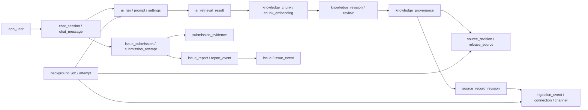

# Mô hình dữ liệu AI Support hiện hành

Schema `ai_support` có **38 bảng** cho một ứng dụng AI. Các đường nối là quan hệ logic; backend kiểm soát chúng trong transaction, không có khóa ngoại hoặc trigger. Mỗi cột có mô tả trong SQL. [Hướng dẫn chạy](../database/README.md) · [Rà soát DB](../database/review.md)

## 01_identity_chat.sql

| Bảng | Mục đích |
|---|---|
| `app_user` | Người dùng ứng dụng; liên kết danh tính từ hệ thống đăng nhập và vai trò sử dụng AI. |
| `chat_session` | Một phiên hội thoại thuộc một người dùng; API phải kiểm tra chủ sở hữu. |
| `chat_message` | Tin nhắn người dùng và AI; khóa yêu cầu giúp chống gửi lặp. |
| `message_citation` | Dẫn chứng công khai gắn đúng lần gọi AI, bản tri thức và đoạn nội dung đã dùng. |
| `file_asset` | Metadata file đính kèm; nội dung file nằm trong object storage và phải quét trước khi dùng. |
| `app_setting_revision` | Lịch sử cấu hình mô hình, prompt và retrieval của ứng dụng; chỉ lưu tham chiếu bí mật. |
| `prompt_template_revision` | Phiên bản prompt có hash và trạng thái; lần gọi AI pin đúng revision hoặc prompt ngoài. |
| `ai_run` | Truy vết một lần gọi AI: model, prompt, token, độ trễ, chi phí ước tính và lỗi. |
| `chat_feedback` | Đánh giá câu trả lời AI để theo dõi chất lượng và cải thiện tri thức. |
| `audit_event` | Dấu vết thao tác quản trị, thay đổi cấu hình, tri thức và nguồn dữ liệu. |
| `ai_retrieval_result` | Các chunk được truy xuất cho một lần gọi AI, gồm cả kết quả không được chọn vào prompt. |

## 02_knowledge.sql

| Bảng | Mục đích |
|---|---|
| `knowledge_item` | Đầu mục tri thức ổn định; loại nội dung khác với cách thu thập. |
| `knowledge_revision` | Nội dung tri thức có phiên bản, nguồn tạo, quyền xem, mức tin cậy và trạng thái duyệt. |
| `knowledge_review` | Nhật ký duyệt, từ chối, công bố và hết hiệu lực của bản tri thức. |
| `knowledge_revision_asset` | File/ảnh minh họa gắn với một bản tri thức. |
| `knowledge_chunk` | Đoạn nội dung đã khử nhạy cảm dùng cho truy xuất văn bản và vector trong MVP. |
| `knowledge_provenance` | Dấu vết nguồn của tri thức được nhập hoặc sinh tự động. |

## 03_issues.sql

| Bảng | Mục đích |
|---|---|
| `issue_submission` | Đề nghị gửi vấn đề trước tiếp nhận, giữ quyền sở hữu và nguồn gốc riêng. |
| `submission_attempt` | Từng lần xác nhận và lọc đề nghị; giữ payload, consent, kết quả và lý do. |
| `submission_evidence` | Bằng chứng từ chat, phiên bản nguồn hoặc file gắn với đề nghị. |
| `issue` | Vấn đề tổng hợp nội bộ để phân công, xác minh và theo dõi đến khi giải quyết. |
| `issue_report` | Phản ánh đã tiếp nhận từ một lần gửi đạt; nhiều phản ánh có thể cùng một vấn đề. |
| `report_event` | Lịch sử đính chính, phản hồi và rút của từng phản ánh riêng. |
| `issue_event` | Lịch sử xử lý và thay đổi nội bộ của vấn đề tổng hợp. |

## 04_releases_sources.sql

| Bảng | Mục đích |
|---|---|
| `product_release` | Một bản triển khai sản phẩm theo môi trường; giữ release hiện hành để RAG dùng đúng phiên bản. |
| `source_revision` | Snapshot repository theo commit cùng manifest source/ERD cho pipeline phân tích nền. |
| `release_source` | Manifest liên kết từng thành phần của bản triển khai với snapshot repository chính xác. |
| `knowledge_revision_release` | Lịch sử áp dụng bản tri thức theo release, kiểm soát một bản hiện hành cho mỗi đầu mục. |

## 05_external_connectors.sql

| Bảng | Mục đích |
|---|---|
| `source_platform` | Danh mục nền tảng nguồn; mở rộng Zalo, Discord, Telegram hoặc nguồn khác bằng dữ liệu. |
| `source_connection` | Kết nối và namespace nguồn, adapter, quyền đã xác minh, cấu hình và tham chiếu secret. |
| `source_channel` | Phạm vi được phép thu thập cùng trạng thái, cursor và tiến độ đồng bộ. |
| `source_record` | Danh tính bản ghi ngoài ổn định; giữ tác giả, quan hệ trao đổi và bản hiện hành. |
| `ingestion_event` | Inbox sự kiện bền vững, chống xử lý trùng và hỗ trợ retry theo connection/event key. |
| `source_record_revision` | Snapshot nội dung và đính kèm theo sự kiện tạo/sửa/xóa; giữ bằng chứng nguồn bất biến. |

## 06_background_jobs.sql

| Bảng | Mục đích |
|---|---|
| `background_job` | Job nền có khóa chống trùng, retry, lease và checkpoint. |
| `background_job_attempt` | Lịch sử từng lần worker chạy job, thời gian, lease token và lỗi đã khử nhạy cảm. |

## 10_vector.sql

| Bảng | Mục đích |
|---|---|
| `embedding_model` | Mô hình embedding và số chiều; đổi model tạo bản ghi mới. |
| `chunk_embedding` | Vector của chunk theo model; backend kiểm tra chunk và model tồn tại, đúng hash, còn hiệu lực. |

## Các ràng buộc liên bảng cần giữ

- Snapshot repository không thay thế record revision: provenance trỏ đúng cấp nguồn đã dùng; release_source pin commit của từng thành phần sản phẩm.
- Revision global chỉ có một bản published mỗi item. Revision theo release cần mapping hiện hành đúng item/release; thay mapping không sửa lịch sử citation.
- Consent thuộc đúng payload/attempt/submission; chỉ attempt đạt mới tạo report; quyền xem report không suy ra từ quyền biết mã issue tổng hợp.
- Inbox event phải cùng connection với record qua channel; current_revision phải thuộc chính record đó.
- Citation phải thuộc response của đúng ai_run; chunk và hash retrieval phải khớp revision.
- Model/số chiều/hash embedding phải khớp; source bị thu hồi phải bị loại khỏi retrieval trước khi vào prompt.
- Lease token của job chặn worker cũ ghi kết quả sau khi mất lease.

`database/sql/91_integrity_audit.sql` kiểm tra 75 quan hệ và 20 quy tắc chéo bảng. Payload đã duyệt, prompt/config đã dùng và evidence phải được giữ bất biến bởi service; schema không có trigger thực thi vòng đời.

Các SVG trong `docs/diagrams/erd-*.svg` là bản lịch sử 30 bảng; không dùng làm nguồn thiết kế hiện hành.
