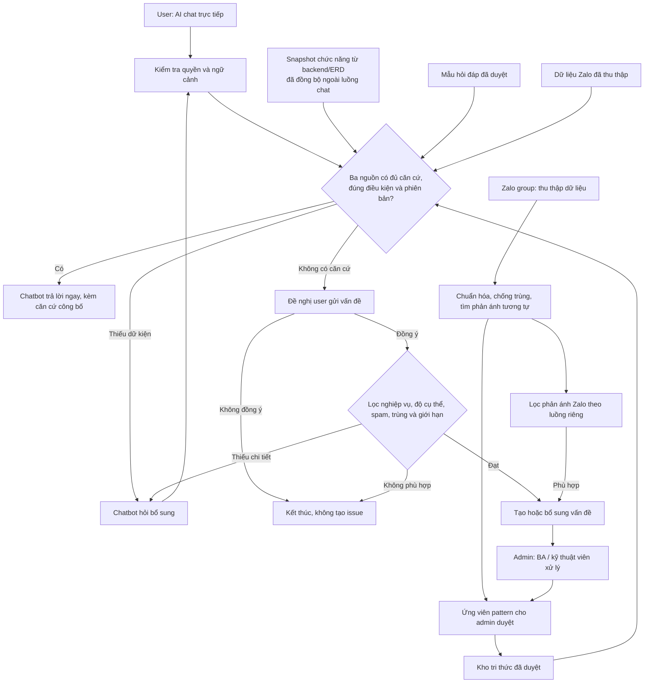

# AI Integration cho hỗ trợ người dùng và tổng hợp issue nghiệp vụ

- **Phiên bản tài liệu:** 1.6
- **Ngày soạn:** 01/11/2026
- **Trạng thái:** Đề xuất thiết kế, làm cơ sở xác nhận yêu cầu và triển khai MVP.
- **Phạm vi:** Giải đáp nghiệp vụ cho người dùng non-tech; tiếp nhận, làm rõ và tổng hợp vấn đề cho đội dự án.

> **Phạm vi MVP cập nhật 02/11/2026:** trước mắt bạn tự nhập mẫu tri thức để thử, chưa kết nối repository/ERD/DB nghiệp vụ hoặc nền tảng bên ngoài. Các mô tả ba nguồn tự động bên dưới là định hướng mở rộng. [Phạm vi chạy trước](mvp-scope.md). Dữ liệu của chính app dùng UUID PK + code UNIQUE; liên kết UUID do backend tự kiểm soát, không khai báo foreign key.

> Nguyên tắc cốt lõi: AI đối chiếu ba nguồn ngữ cảnh chính — bản tóm tắt chức năng được cập nhật từ source backend/ERD của phiên bản đang chạy, mẫu hỏi đáp và dữ liệu Zalo group. Chatbot chỉ trả lời khi có căn cứ phù hợp và được phép công bố; nếu thiếu hoặc mâu thuẫn thì đề nghị user gửi vấn đề; chỉ tạo/gộp issue sau khi user đồng ý và nội dung qua bộ lọc chống spam. Zalo là nguồn thu thập, không phải kênh bot trả lời.

**Phân quyền:** `user` dùng Trợ lí thông minh và Vấn đề của mình. `technician` dùng Trợ lí thông minh, quản lý toàn bộ Vấn đề và soạn Kho tri thức. `admin` có toàn quyền, gồm duyệt tri thức và Cấu hình. Quyền được thực thi tại backend và lớp truy xuất dữ liệu, không dựa vào việc ẩn menu.

### Ma trận quyền

| Chức năng | admin | technician | user |
|---|---|---|---|
| Trợ lí thông minh | Có, phiên riêng | Có, phiên riêng | Có, phiên riêng |
| Vấn đề | Toàn bộ | Toàn bộ, phân công và xử lý | Chỉ phản ánh do chính mình tạo/gửi |
| Kho tri thức | Xem, soạn, duyệt, hết hiệu lực | Xem, soạn/sửa bản nháp; sửa mẫu đã duyệt phải chờ duyệt lại | Không |
| Cấu hình, đặt lại demo | Có | Không | Không |
| Thu thập Zalo | Có | Có | Không |

User có đúng hai tab **Trợ lí thông minh** và **Vấn đề**. Tab Vấn đề hiển thị nội dung riêng đã gửi, trạng thái, đính chính và rút phản ánh theo quy tắc hiện hành. Không hiển thị tóm tắt nội bộ, lịch sử xử lý nội bộ, dữ liệu Zalo hoặc phản ánh của người khác dù được gộp cùng issue. Quyền sở hữu lấy từ danh tính đăng nhập và trường người tạo/người gửi; không suy ra từ việc biết mã issue hoặc có liên kết tới hội thoại.

Demo HTML dùng bộ chọn tài khoản và localStorage để minh họa; không phải cơ chế bảo mật. Khi triển khai thật, Spring Boot phải kiểm tra vai trò, quyền sở hữu tại mọi API và truy vấn dữ liệu; backend xác định người tạo, không nhận danh tính do client tự khai. Kiểm thử trường hợp đổi ID phản ánh/issue sang tài khoản khác, gộp nhiều phản ánh và gọi trực tiếp API bị cấm.

## 1. Bối cảnh và bài toán

Dự án đã được đưa đến người dùng thực tế, có group khoảng 1.000 thành viên cần hỗ trợ. Khối lượng tin nhắn lớn khiến câu hỏi và phản ánh dễ bị bỏ sót hoặc chưa được theo dõi đến khi giải quyết xong.

Nghiệp vụ dự án vẫn đang hoàn thiện. Một số tình huống đã có câu trả lời được xác nhận; một số tình huống còn mơ hồ hoặc hệ thống chưa đáp ứng, cần làm rõ và có thể dẫn đến thay đổi source code.

Hệ thống AI cần hỗ trợ đồng thời hai bài toán:

1. Giải đáp những tình huống có căn cứ phù hợp bằng ngôn ngữ dễ hiểu.
2. Ghi nhận và tổng hợp những tình huống chưa giải quyết được để đội dự án xác nhận, phân loại và xử lý.

**Đã trả lời không đồng nghĩa đã giải quyết. Đã duyệt thay đổi không đồng nghĩa đã triển khai.**

## 2. Mục tiêu và đầu ra

### 2.1. Kênh chat hỗ trợ người dùng

Khách hàng (`user`) nhắn trực tiếp với chatbot trong các phiên trò chuyện có lịch sử riêng. Hệ thống đối chiếu ba nguồn ngữ cảnh; khi có kết luận đủ căn cứ, đúng quyền, điều kiện và phiên bản, chatbot trả lời ngay kèm nguồn được phép công bố và ảnh hướng dẫn nếu mẫu trả lời đã duyệt có ảnh. Khi thiếu dữ kiện, bot hỏi bổ sung. Khi chưa có căn cứ phù hợp hoặc nguồn mâu thuẫn, chatbot thông báo giới hạn và đề nghị user gửi vấn đề đến đội phụ trách. Việc hỏi không tự tạo issue. User có thể chủ động bấm **Đề nghị gửi vấn đề** trong chat, nhưng vẫn phải xác nhận gửi. Sau xác nhận, backend kiểm tra tính liên quan, mức độ cụ thể, spam, giới hạn gửi và phản ánh trùng. Chỉ khi qua bước lọc mới tạo/gộp issue và hiện mã, trạng thái dưới câu trả lời. User có thể mở tab **Vấn đề** (có lối tắt **Vấn đề của tôi** trong chat) để theo dõi, đính chính hoặc rút phản ánh của mình theo trạng thái xử lý.

Câu trả lời phải:

- Dễ hiểu với người dùng non-tech.
- Phù hợp điều kiện nghiệp vụ và phiên bản đang áp dụng.
- Hỏi bổ sung khi thiếu thông tin.
- Đề nghị chuyển người phụ trách khi chưa có căn cứ trả lời; chỉ gửi sau khi user đồng ý và nội dung qua bộ lọc.
- Không tiết lộ thông tin kỹ thuật nội bộ hoặc thông tin mật.

### 2.2. Hệ thống quản lý vấn đề và danh sách issue cho dev

Admin và technician (BA, kỹ thuật viên và người phụ trách) có danh sách vấn đề tập trung. Hệ thống ghi nhận phản ánh từ AI chat sau khi user xác nhận và qua bộ lọc; dữ liệu Zalo được thu thập, phân loại theo luồng riêng, rồi mới bổ sung phản ánh phù hợp, giữ phản ánh gốc, nguồn, người bị ảnh hưởng, kết quả làm rõ và bước xử lý tiếp theo.

Danh sách này cần phân biệt:

- Câu hỏi đã có hướng dẫn.
- Trường hợp đang thiếu thông tin.
- Nội dung chờ xác nhận nghiệp vụ.
- Nghi vấn lỗi triển khai.
- Yêu cầu thay đổi hoặc nhu cầu hệ thống chưa hỗ trợ.

Không chuyển mọi câu hỏi chưa trả lời được thành bug cho dev.

## 3. Input và vai trò của từng nguồn

| Input | Vai trò | Điều kiện sử dụng |
|---|---|---|
| Source backend | Nguồn gốc để tạo bản tóm tắt chức năng và đối chiếu hành vi đang chạy | Đồng bộ nền theo commit/bản triển khai; chỉ xử lý module thay đổi, khử thông tin mật |
| ERD | Nguồn gốc để tạo bản tóm tắt quan hệ dữ liệu theo chức năng | Đồng bộ nền theo migration/phiên bản; không suy từ cấu trúc bảng ra toàn bộ quy tắc nghiệp vụ |
| Pattern câu hỏi và câu trả lời | Nguồn ngữ cảnh chính cho cách hỏi, câu trả lời và ảnh hướng dẫn đã biết | Cần duyệt nội dung, ảnh, điều kiện, phiên bản và phạm vi công bố |
| Lịch sử Zalo group | Nguồn ngữ cảnh chính về câu hỏi, phản ánh và tình huống thực tế của khách hàng | Không gửi câu trả lời vào group; ý kiến hoặc câu trả lời cũ không tự là quy tắc chính thức |
| Tin nhắn AI chat | User hỏi trực tiếp chatbot; chỉ nhận mã ghi nhận sau khi đồng ý gửi và qua bộ lọc | Giữ hội thoại và quyền truy cập của user |
| Tin nhắn Zalo mới | Dữ liệu nhóm cho luồng thu thập và tổng hợp vấn đề | Giữ ID, người gửi, thời gian và quan hệ trả lời nếu có |
| Trigger tin nhắn mới | Khởi động xử lý khi nhận sự kiện | Phụ thuộc khả năng tích hợp thực tế của nền tảng |
| Job định kỳ | Đồng bộ/tóm tắt source và ERD; rà soát việc tồn | Chỉ phân tích phần thay đổi, tránh xử lý trùng với trigger |

**Điểm cần xác minh trước triển khai:** cơ chế truy cập group Zalo, quyền đọc tin nhắn, khả năng nhận sự kiện, lấy lịch sử và nội dung đính kèm. Hệ thống không cần quyền gửi phản hồi vào group cho luồng đã chốt. Tài liệu này chưa khẳng định quyền đọc đã sẵn sàng.

## 4. Tổ chức kiến thức và ranh giới truy cập

### 4.1. Kho kiến thức dành cho kênh user

Chứa các pattern, hướng dẫn và kết luận đã được kiểm tra, được phép công bố cho đúng đối tượng.

Mỗi mục kiến thức nên có:

| Trường | Ý nghĩa |
|---|---|
| Mã và tiêu đề | Nhận diện nội dung |
| Câu hỏi mẫu | Các cách diễn đạt tình huống |
| Điều kiện áp dụng | Trạng thái, vai trò, bước quy trình và trường hợp loại trừ |
| Câu trả lời | Hướng dẫn bằng ngôn ngữ nghiệp vụ |
| Ảnh trong câu trả lời | Tệp ảnh, mô tả ảnh, quyền truy cập và phiên bản; chỉ công bố cùng bản đã duyệt |
| Nguồn xác nhận | Tài liệu hoặc quyết định làm căn cứ |
| Người xác nhận | Người chịu trách nhiệm về nội dung |
| Trạng thái | Nháp, đã duyệt, hết hiệu lực |
| Phiên bản và thời gian áp dụng | Tránh sử dụng hướng dẫn không đúng môi trường |
| Phạm vi công bố | Nhóm người dùng được phép tiếp cận |

Nội dung đã duyệt nhưng chưa triển khai phải được nhận diện riêng, không dùng để hướng dẫn như tính năng đã có.

### 4.2. Kho thông tin nội bộ

Chứa source code, ERD, kết quả phân tích kỹ thuật, câu hỏi mở và quyết định đang chờ xử lý. AI có thể tra cứu các đoạn đã lập chỉ mục, khử nhạy cảm và gắn phiên bản để đối chiếu hành vi hiện tại. Quyền truy cập nguồn thô chỉ dành cho nhân sự được phân quyền.

Kết quả đối chiếu nội bộ có thể hỗ trợ câu trả lời cho user sau bước kiểm tra quyền và công bố. Không chuyển nguyên code, ERD hoặc suy luận chưa xác nhận sang kênh user.

### 4.3. Snapshot chức năng từ source và ERD

Source code và ERD có thể rất lớn, nên việc đọc và suy luận toàn bộ trong lúc khách hàng chờ là không khả thi. Hệ thống duy trì **kho tóm tắt chức năng** được tạo ngoài luồng chat:

1. Khi có commit/deploy hoặc theo lịch, lấy bản production đang chạy và so sánh với lần đồng bộ trước. Xác định module, endpoint, service và migration/ERD thay đổi bằng metadata và hash; bỏ qua phần không đổi.
2. Tách theo chức năng, phân tích phần thay đổi cùng ngữ cảnh phụ thuộc cần thiết. AI hỗ trợ tóm tắt theo cấu trúc giới hạn, không đưa cả repository vào một prompt. Kiểm tra liên kết tới file/commit và các thực thể ERD trước khi xuất bản.
3. Mỗi bản tóm tắt lưu: chức năng, luồng xử lý chính, điều kiện/quyền, thực thể dữ liệu liên quan, hành vi triển khai, điểm chưa chắc chắn, file tham chiếu, commit, bản production, thời điểm đồng bộ, quyền công bố và trạng thái duyệt. Phân biệt **hành vi code đang chạy** với **quy tắc nghiệp vụ đã xác nhận**.
4. Chỉ xuất bản bản tóm tắt phù hợp với production và đã qua kiểm tra cho truy xuất của chatbot. Nội dung chưa chắc chắn hoặc mâu thuẫn chuyển BA/kỹ thuật viên rà soát; không tự công bố như sự thật nghiệp vụ.
5. Cập nhật chỉ mục tìm kiếm khi snapshot mới được xuất bản. Giữ snapshot cũ để đối chiếu lịch sử nhưng không dùng nó cho câu trả lời về phiên bản hiện tại.

Khi khách hàng hỏi, RAG tìm trong bản tóm tắt đã xuất bản, pattern đã duyệt và dữ liệu Zalo phù hợp. Request chat **không chạy trace source/ERD đầy đủ**. Nếu bản tóm tắt thiếu, cũ hoặc không đúng production, bot nêu rõ chưa đủ căn cứ và dùng luồng hỏi thêm/đề nghị gửi vấn đề. Nhu cầu truy vết sâu được đưa vào job bất đồng bộ cho admin; kết quả có thể dùng cập nhật snapshot sau khi kiểm chứng. Cách này giới hạn độ trễ và chi phí; thời gian phản hồi mục tiêu được chốt bằng pilot.

### 4.4. Quan hệ giữa các nguồn

| Loại thông tin | Có thể kết luận | Không được tự suy ra |
|---|---|---|
| Nghiệp vụ đã xác nhận | Quy tắc được thống nhất trong phạm vi hiệu lực | Mọi phiên bản đã triển khai quy tắc đó |
| Source và cấu hình đang chạy | Hệ thống hiện thực hiện điều gì | Hành vi đó chắc chắn đúng nghiệp vụ |
| ERD | Quan hệ và cấu trúc dữ liệu được mô tả | Toàn bộ điều kiện, quyền và quy trình thực tế |
| Phản ánh user | Người dùng đang gặp tình huống hoặc có nhu cầu cụ thể | Hệ thống chắc chắn có bug |
| Quyết định thay đổi | Hướng xử lý đã được duyệt | Thay đổi đã có trên production |

## 5. Kiến trúc chức năng đề xuất

Hệ thống có hai đầu vào và một kho vấn đề chung:

1. **AI chat trực tiếp:** user hỏi hoặc báo vấn đề; chatbot đối chiếu snapshot chức năng từ backend/ERD, mẫu hỏi đáp và dữ liệu Zalo để trả lời có căn cứ, hỏi thêm, hoặc đề nghị user gửi vấn đề khi chưa rõ. Chỉ sau xác nhận và lọc, mã/trạng thái mới hiện trong chat.
2. **Thu thập Zalo:** lấy tin group trong phạm vi được phép, chuẩn hóa, lọc nội dung liên quan và chống trùng, tìm phản ánh tương tự rồi bổ sung vấn đề phù hợp hoặc đề xuất pattern cho admin xem. Không trả lời trong group.
3. **Khu vực admin:** BA/kỹ thuật viên xem vấn đề, xác nhận nghiệp vụ, cập nhật kho tri thức và theo dõi kết quả.

Sơ đồ mô tả luồng chức năng. Việc tách quyền truy cập phải được thực thi ở backend và lớp truy xuất dữ liệu, không chỉ bằng prompt.

## 6. Quy trình xử lý một câu hỏi

### Bước 1 — Tiếp nhận và lưu dấu vết

Lưu câu hỏi AI chat cùng hội thoại, user và thời gian. Với Zalo, lưu ID tin nhóm, người gửi, thời gian và ngữ cảnh trong phạm vi được phép. Tách nguồn `ai_chat` và `zalo_group`; chống trùng từng nguồn và nhận diện phản ánh bổ sung cho vấn đề đã có.

### Bước 2 — Làm rõ tình huống

Nhận diện mục đích, đối tượng nghiệp vụ, bước quy trình và thông tin còn thiếu. Nếu chưa đủ điều kiện để chọn hướng dẫn, hỏi bổ sung thay vì đoán.

### Bước 3 — Tìm kiến thức phù hợp

Tra cứu snapshot chức năng đã xuất bản, đúng bản đang chạy, pattern đã duyệt và dữ liệu Zalo liên quan. Đối chiếu hành vi triển khai với quy tắc đã xác nhận; kiểm tra điều kiện, phiên bản, độ tin cậy và quyền tiếp cận trước khi soạn câu trả lời. Zalo giúp hiểu tình huống nhưng không tự xác lập đáp án đúng.

### Bước 4 — Chọn hướng xử lý

| Kết quả | Hành động | Đơn vị tiếp nhận khi cần |
|---|---|---|
| Có hướng dẫn đã duyệt, phù hợp và đủ thông tin | Chatbot trả lời trực tiếp, kèm căn cứ được phép công bố | User nhận ngay |
| Thiếu thông tin | Chatbot hỏi bổ sung, giữ ngữ cảnh hội thoại | User |
| Chưa có căn cứ, quy định chưa rõ hoặc nguồn mâu thuẫn | Nói rõ chưa thể kết luận và hỏi user có muốn gửi vấn đề; chưa tạo issue | User quyết định |
| User đồng ý gửi hoặc chủ động đề nghị gửi | Lọc tính liên quan, độ cụ thể, spam, trùng và tần suất; đạt thì tạo/gộp issue và hiện mã/trạng thái | Admin / BA / kỹ thuật viên |
| Có dấu hiệu khác yêu cầu đã xác nhận | Sau khi user đồng ý và nội dung qua bộ lọc, ghi nhận bằng chứng; admin xác nhận trước khi gán nhãn bug | BA, Dev và người kiểm thử |
| User cần khả năng chưa được hỗ trợ | Đề nghị gửi; sau xác nhận và lọc, đề xuất phân loại thay đổi | Product / BA |

Bộ lọc không dùng riêng kết luận của AI: backend áp dụng kiểm tra cứng về quyền, tần suất, trùng lặp và trạng thái; AI đánh giá ngữ nghĩa, tính liên quan và độ cụ thể. Nội dung mơ hồ được hỏi thêm thay vì tạo issue; trường hợp không chắc chắn không bị loại vĩnh viễn mà có thể bổ sung rồi gửi lại. Cần thử bộ lọc bằng dữ liệu đã gán nhãn để giảm chặn nhầm phản ánh thật. Lưu sự đồng ý, quyết định lọc và lý do. Admin kiểm tra trước khi xác nhận bug, quy tắc nghiệp vụ mới hoặc thay đổi sản phẩm.

### Bước 5 — Theo dõi đến khi có kết quả

Gán người phụ trách, lưu bước tiếp theo và theo dõi phản hồi. Nếu phát sinh thay đổi, tiếp tục theo dõi qua phát triển, kiểm thử, triển khai và thông báo lại user.

### Bước 6 — User quản lý phản ánh đã gửi

- Trong tab **Vấn đề**, danh sách của user liệt kê các phản ánh do chính user gửi, gồm mã, trạng thái và lịch sử đính chính. User không được truy cập danh sách toàn hệ thống hoặc thông tin nội bộ.
- User được **bổ sung/đính chính** khi issue đang chờ hoặc đang xử lý. Nội dung mới được thêm thành bản ghi có thời gian và người gửi; không ghi đè lời mô tả gốc. BA/kỹ thuật viên thấy cập nhật và có thể điều chỉnh bước xử lý.
- User được **rút phản ánh** khi issue còn ở trạng thái chờ xử lý. Hệ thống giữ nội dung và dấu vết rút để kiểm toán. Nếu issue đang gộp phản ánh của người khác hoặc từ Zalo, chỉ liên kết của user này bị rút; issue chung vẫn tiếp tục. Nếu không còn nguồn phản ánh nào, issue chuyển trạng thái đã rút.
- Khi issue đang xử lý, không cho rút trực tiếp; user gửi đính chính để đội phụ trách xem. Issue đã hoàn tất được giữ nguyên; phát sinh mới đi qua luồng chat/gửi vấn đề mới.
- API phải kiểm tra danh tính và quyền sở hữu từng phản ánh; user không được xem hoặc sửa nội dung riêng của người khác, kể cả khi cùng một issue tổng hợp.

## 7. Quy tắc trả lời người dùng non-tech

### 7.1. Nội dung được trả lời

- Các bước thao tác trên giao diện.
- Điều kiện nghiệp vụ đã xác nhận và được phép công bố.
- Thông tin còn thiếu cần user cung cấp.
- Trạng thái tiếp nhận và xử lý đã được xác minh.
- Tên hoặc đường dẫn tài liệu mà user được quyền đọc.

### 7.2. Nội dung không được tiết lộ

- ERD, cấu trúc bảng, tên cột hoặc quan hệ dữ liệu nội bộ.
- Source code, tên hàm, tên class, đường dẫn repository, truy vấn SQL hoặc stack trace.
- Khóa bí mật, token, mật khẩu và thông tin cấu hình nhạy cảm.
- Thông tin cá nhân, hồ sơ hoặc dữ liệu của người khác ngoài quyền truy cập.
- Nội dung phân tích và trao đổi nội bộ chưa được phép công bố.

Không tự hứa thời hạn sửa hoặc cam kết phát triển tính năng khi chưa có quyết định.

### 7.3. Ví dụ

**User hỏi:**

> Tôi gửi hồ sơ rồi, nhập sai số điện thoại thì sửa thế nào?

**Nếu có hướng dẫn đã xác nhận và phù hợp phiên bản:**

> Bạn mở chi tiết hồ sơ và chọn “Chỉnh sửa”. Thao tác này áp dụng khi hồ sơ chưa được tiếp nhận. Nếu không thấy nút, bạn cho biết trạng thái đang hiển thị để mình kiểm tra tiếp nhé.

**Nếu chưa có kết luận phù hợp:**

> Mình chưa có căn cứ đã xác nhận cho trường hợp sửa thông tin sau khi gửi. Bạn cho biết trạng thái hồ sơ hiện tại nhé; sau đó bạn có thể chọn gửi vấn đề này đến đội phụ trách.

**Không trả lời:**

> Backend chỉ cho cập nhật khi status = DRAFT trong HoSoService.

Các tên chức năng, trạng thái và ví dụ trong tài liệu chỉ mang tính minh họa; không khẳng định đó là nghiệp vụ của dự án thực tế.

## 8. Cấu trúc issue nội bộ

Đơn vị quản lý là một vấn đề, không phải từng tin nhắn. Một vấn đề có thể liên quan nhiều người và nhiều lần trao đổi.

| Trường | Nội dung cần lưu |
|---|---|
| Mã vấn đề | ID duy nhất |
| Tiêu đề và tóm tắt | Nêu rõ tình huống và nhu cầu |
| Ngữ cảnh áp dụng | Trạng thái hồ sơ, vai trò, bước quy trình, môi trường |
| Mong muốn của user | Kết quả người dùng cần đạt |
| Hành vi được phản ánh | Những gì user quan sát được |
| Kết quả kiểm chứng | Điều đã tái hiện hoặc xác minh; tách khỏi suy luận |
| Người bị ảnh hưởng | Danh sách riêng từng người và trường hợp; mỗi phản ánh gắn `userId` chủ sở hữu |
| Lịch sử đính chính/rút | Nội dung gốc, từng đính chính, người gửi, thời gian và trạng thái rút; không ghi đè dữ liệu gốc |
| Bằng chứng hội thoại | ID/link tin nhắn, thời gian và thông tin bổ sung |
| Đồng ý và lọc (nguồn AI chat) | Thời điểm user xác nhận, kết quả đánh giá, lý do và ID yêu cầu để chống gửi lặp |
| Bằng chứng nội bộ | Vị trí source, tài liệu, phiên bản hoặc commit đã đối chiếu |
| Điểm chưa rõ | Câu hỏi cần quyết định hoặc dữ kiện còn thiếu |
| Phân loại đề xuất | Câu hỏi, nghi vấn lỗi, thay đổi, chờ nghiệp vụ |
| Người phụ trách | Người hoặc nhóm tiếp nhận |
| Quyết định | Kết luận, người xác nhận và thời điểm |
| Theo dõi triển khai | Công việc liên quan, bản mục tiêu và bản thực tế |
| Tiêu chí hoàn tất | Điều kiện xác định đã giải quyết |
| Theo dõi phản hồi user | Ai đã được báo lại, ai còn chờ |

### Ví dụ issue

- **Vấn đề:** Người dùng muốn sửa số điện thoại sau khi gửi hồ sơ.
- **Ngữ cảnh:** Hồ sơ chưa được tiếp nhận.
- **Hành vi phản ánh:** Không có thao tác chỉnh sửa.
- **Bằng chứng nội bộ:** Cần kiểm tra điều kiện cập nhật trong phiên bản production.
- **Điểm chưa rõ:** Có cho phép sửa trong giai đoạn trước tiếp nhận hay không?
- **Phân loại đề xuất:** Chờ xác nhận nghiệp vụ.
- **Bước tiếp theo:** Chuyển người phụ trách nghiệp vụ xác nhận trước khi kết luận lỗi hoặc yêu cầu dev sửa.

Hệ thống tự gợi ý/tạo liên kết phản ánh tương tự từ AI chat và Zalo. Không gộp mất các trường hợp khác điều kiện hoặc xóa dấu vết riêng của từng user.

## 9. Trigger, job định kỳ và cập nhật phiên bản

| Cơ chế | Trách nhiệm |
|---|---|
| Tin AI chat mới | Tìm snapshot chức năng và kiến thức đã duyệt, đúng production; trả lời trực tiếp khi đủ căn cứ; nếu không, hỏi thêm hoặc đề nghị user gửi vấn đề; chỉ tạo sau xác nhận và lọc |
| Commit/deploy hoặc lịch đồng bộ source/ERD | Tạo/cập nhật snapshot chức năng theo phần thay đổi; kiểm chứng rồi xuất bản, không chạy trong request chat |
| Trigger Zalo khi có tin mới | Chỉ thu thập, chuẩn hóa và bổ sung bằng chứng/vấn đề; không gửi trả lời vào group |
| Job định kỳ | Rà soát câu hỏi chưa xử lý, tìm phản ánh tương tự, nhắc việc tồn và tạo bản tổng hợp |
| Khi có quyết định nghiệp vụ | Cập nhật nội dung đã xác nhận và điều kiện áp dụng; xác định có cần đổi code hay không |
| Khi có bản phát hành | Xác minh thay đổi đã triển khai, cập nhật hướng dẫn có hiệu lực và tìm user cần báo lại |

Yêu cầu vận hành:

- Nhận diện tin nhắn đã xử lý theo ID để tránh trả lời hoặc tạo issue trùng khi sự kiện được gửi lại hoặc job chạy lại.
- Ghi trạng thái xử lý và lỗi để có thể tiếp tục sau gián đoạn.
- Chỉ tạo thông báo cần hành động hoặc bản tổng hợp phù hợp; tránh phát thêm một thông báo cho mọi tin nhắn.
- Thời hạn và nhắc việc do backend tính theo quy tắc, lịch làm việc được thống nhất.
- Phân biệt thời điểm duyệt quyết định với thời điểm triển khai thực tế.

## 10. Thực thi bảo mật

### 10.1. Tách phạm vi truy xuất

Source backend và ERD là nguồn gốc dữ liệu, nhưng luồng trả lời user chỉ nhận snapshot chức năng đã xuất bản, được lọc quyền, khử thông tin nhạy cảm và gắn đúng commit/bản production. Không cho mô hình tự duyệt toàn repository hoặc dùng dữ liệu của user khác. Quyền được kiểm soát ở backend và lớp truy xuất trước khi ngữ cảnh được đưa cho mô hình.

### 10.2. Kiểm soát nội dung đưa ra ngoài

Không chuyển nguyên kết quả phân tích nội bộ sang kênh user. Nếu cần phản hồi từ kết quả nội bộ, chỉ chuyển phần kết luận đã được phép công bố sang bước soạn câu trả lời dành cho user.

Kiểm tra nội dung đầu ra là lớp bổ sung, không thay thế việc tách quyền và hạn chế nguồn truy xuất.

### 10.3. Xử lý nguồn dữ liệu

- Loại bỏ hoặc che thông tin mật trước khi đưa vào quy trình AI; không lập chỉ mục các khóa bí mật và thông tin đăng nhập.
- Chỉ gửi dữ liệu cần thiết cho mục đích xử lý.
- Tin nhắn user, tài liệu và source được coi là dữ liệu tham chiếu, không có quyền thay đổi chỉ dẫn hoặc cấp thêm quyền cho AI.
- Lưu dấu vết nguồn và thao tác để kiểm tra khi có câu trả lời sai hoặc phân loại sai.

## 11. Phân công AI, backend và con người

| Thành phần | Trách nhiệm |
|---|---|
| AI | Hiểu câu hỏi, trả lời trực tiếp từ căn cứ đã duyệt khi đủ điều kiện, hỏi bổ sung, tóm tắt và đề xuất phân loại vấn đề |
| Backend | Thực thi quyền admin/technician/user, lọc căn cứ, kiểm tra sự đồng ý, lọc rồi tạo/gộp issue, truy xuất dữ liệu, chống trùng, điều phối tác vụ và ghi lịch sử |
| Admin / Support | Theo dõi hội thoại và vấn đề; can thiệp khi cần, quản lý tri thức theo quyền được giao |
| Người phụ trách nghiệp vụ / BA | Xác nhận quy tắc, giải quyết mâu thuẫn và thống nhất thay đổi |
| Dev và người kiểm thử | Kiểm tra triển khai, tái hiện lỗi, sửa đổi và xác minh kết quả |

AI không tự xác nhận nghiệp vụ mới hoặc sửa production trong phạm vi MVP này.

## 12. Phạm vi MVP và lộ trình

### Giai đoạn 1 — AI chat và issue có xác nhận

- User đăng nhập và dùng hai tab Trợ lí thông minh, Vấn đề của mình; technician có thêm Kho tri thức và xử lý toàn bộ vấn đề; admin có toàn quyền gồm Cấu hình và duyệt tri thức.
- Dựng pipeline nền tạo snapshot chức năng từ source backend/ERD của bản đang chạy; lập chỉ mục snapshot đã xuất bản, pattern đã xác nhận và dữ liệu Zalo được phép dùng; mỗi mục có nguồn, quyền và phiên bản.
- Mẫu trả lời có thể gắn ảnh; ảnh mới hoặc ảnh sửa phải duyệt cùng nội dung trước khi xuất hiện trong chat.
- Chatbot trả lời trực tiếp khi đủ căn cứ; hỏi bổ sung khi thiếu dữ kiện.
- Khi không có căn cứ hoặc nguồn mâu thuẫn, chatbot đề nghị user gửi vấn đề. User xác nhận; backend lọc nội dung liên quan, đủ chi tiết, spam, trùng và giới hạn gửi; đạt thì tạo/gộp issue, lưu hội thoại gốc, hiện mã/trạng thái trong chat. Nút đề nghị gửi cũng đi qua luồng này.
- User xem phản ánh do chính mình gửi ở tab **Vấn đề**, gửi đính chính và rút phản ánh còn chờ xử lý; admin/technician xem issue, gán người phụ trách và theo dõi trạng thái.
- Thu thập tin Zalo qua quyền đã xác minh hoặc import, chỉ để phân tích/tổng hợp; không trả lời trong group.

Trước khi mở cho toàn bộ user, chạy pilot với bộ hội thoại đã gán nhãn để kiểm chứng điều kiện trả lời, tỷ lệ từ chối và độ chính xác của bộ lọc vấn đề và tỷ lệ issue rác.

### Giai đoạn 2 — Tổng hợp issue và làm rõ nghiệp vụ

- Tự động gợi ý liên kết phản ánh tương tự từ AI chat và Zalo, có kiểm tra để tránh gộp sai.
- Chuẩn hóa issue theo mẫu ở mục 8.
- Quản lý câu hỏi mở và quyết định nghiệp vụ.
- Bổ sung job định kỳ rà soát và nhắc việc tồn.

### Giai đoạn 3 — Theo dõi thay đổi đến bản phát hành

- Mở rộng phân tích ảnh hưởng từ snapshot và metadata source/ERD đã có trong MVP.
- Hỗ trợ xác định vị trí xử lý và phạm vi ảnh hưởng.
- Liên kết quyết định với công việc dev, kiểm thử và bản phát hành.
- Cập nhật kiến thức có hiệu lực và theo dõi báo lại user.

## 13. Tiêu chí kiểm chứng

| Nhóm | Nội dung kiểm chứng |
|---|---|
| Giải đáp trực tiếp | Chatbot trả lời ngay khi có căn cứ đã duyệt, đúng điều kiện và phiên bản; hỏi thêm khi thiếu dữ kiện |
| Phân quyền và bảo mật | User chỉ thao tác hai tab Trợ lí thông minh và Vấn đề của mình; technician xử lý vấn đề/soạn tri thức; admin quản trị toàn bộ; code/ERD thô và dữ liệu nhóm nhạy cảm không lộ ở kênh user |
| Phân loại | Không tự kết luận câu hỏi chưa có đáp án là bug |
| Gửi vấn đề có xác nhận | Hỏi thiếu căn cứ không tạo issue; user từ chối không tạo; user đồng ý nhưng nội dung mơ hồ/spam không tạo; nội dung hợp lệ tạo/gộp issue và hiện mã/trạng thái; giữ dấu vết đồng ý và nguồn bằng chứng |
| Ảnh câu trả lời | Ảnh gắn với mẫu đã duyệt xuất hiện đúng câu trả lời; ảnh sửa phải duyệt lại và có mô tả thay thế |
| Ba nguồn ngữ cảnh | Snapshot chức năng từ source backend/ERD, pattern và Zalo được lập chỉ mục có loại nguồn, quyền, phiên bản; mâu thuẫn nguồn dẫn đến đề nghị gửi vấn đề |
| Theo dõi và đính chính | User chỉ thấy phản ánh của mình, đính chính được khi chưa hoàn tất, rút được khi chưa bắt đầu xử lý; issue gộp vẫn giữ phản ánh khác; admin thấy lịch sử và bước tiếp theo |
| Chống trùng | Chạy lại trigger/job không tạo phản hồi hoặc issue lặp |
| Phiên bản và độ trễ | Snapshot dùng cho chat phải khớp production; source/ERD được cập nhật ngoài luồng theo diff; chat không chờ trace code dài; quyết định chưa triển khai không được trả lời như chức năng đã có |
| Vòng phản hồi | Thay đổi hoàn tất được liên kết tới các user cần thông báo lại |

Dùng bộ hội thoại thực tế được phép sử dụng, có đáp án và nhãn do đội dự án xác nhận, để đo tỷ lệ bỏ sót, phân loại sai, chất lượng câu trả lời và thời gian tiếp nhận. Ngưỡng chấp nhận cần thống nhất sau khi có số liệu thử nghiệm.

## 14. Các điểm cần chốt trước khi triển khai

1. Cơ chế tích hợp Zalo và các quyền thực tế có sẵn.
2. Vị trí đặt màn AI chat trực tiếp cho khách hàng và cơ chế đăng nhập admin/technician/user.
3. Người có quyền xác nhận nghiệp vụ và duyệt nội dung đưa vào kho kiến thức.
4. Cách xác định phiên bản production tương ứng với source và cấu hình.
5. Nơi quản lý issue và cách chuyển việc cho dev.
6. Bộ điều kiện bắt buộc để chatbot trả lời trực tiếp và ngưỡng chất lượng cần đạt trong pilot.
7. Quyền sử dụng dữ liệu, thời gian lưu và phạm vi dữ liệu được gửi đến mô hình.

---

**Định hướng triển khai:** snapshot chức năng từ source/ERD cùng hai nguồn còn lại được chuẩn bị từ MVP; AI chat trả lời có căn cứ, ảnh hướng dẫn đi cùng mẫu đã duyệt, và vấn đề chỉ được tạo/hiển thị sau khi user đồng ý và qua bộ lọc. Tách riêng thông tin được công bố, hành vi triển khai và quyết định nghiệp vụ trong toàn bộ vòng xử lý.

## 15. Bổ sung yêu cầu: mở rộng nguồn đa nền tảng — 02/11/2026

Zalo là nguồn thu thập ban đầu; thiết kế phải thêm được Discord, Telegram và nền tảng khác qua connector/adapter chung. Dữ liệu được chuẩn hóa thành connection, channel, record và revision; không tạo thêm các cột/bảng nghiệp vụ theo từng tên nền tảng. Tin nhắn, tài liệu hoặc phản ánh bên ngoài vẫn đi qua kiểm tra quyền, lọc nghiệp vụ và quy trình duyệt tri thức như nhau.

Giữ ID và phiên bản nguồn để retry không tạo trùng, theo dõi sửa/xóa và truy vết đúng bằng chứng đã dùng. Không giả định mọi nền tảng đều có webhook, lịch sử hoặc quyền truy cập giống nhau. MVP tiếp tục chỉ thu thập/import; mở rộng nguồn không tự cấp quyền bot gửi tin ra các nền tảng.

Thiết kế cụ thể: [connector đa nền tảng](connectors.md) và [ERD cập nhật](erd.md). Phần bổ sung này mở rộng cách lưu/tiếp nhận nguồn; không thay các nguyên tắc đồng ý gửi phản ánh của AI chat, quyền sở hữu hay duyệt nội dung công bố.
